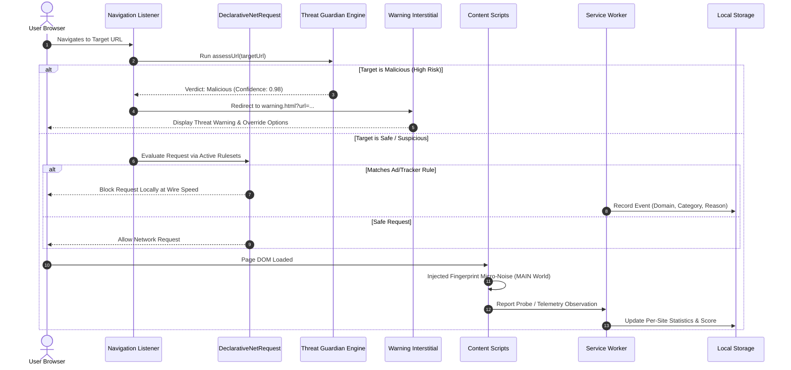

# panH AI Edition — System Architecture & Engineering Blueprint

> **Platform:** Chrome, Edge, Brave, Opera & Firefox (Manifest V3)  
> **Document Version:** 1.0 • 04 November 2026  
> **Core Principle:** Local-First Enforcement • Optional Cloud Intelligence

---

## 1. High-Level System Architecture

panH is structured as a **hybrid local-first architecture**: all network request evaluation, blocking, heuristic scoring, and fingerprint shielding occur strictly within the client browser. Optional cloud services provide threat-feed orchestration, cross-device settings sync, and optional cloud LLM reasoning.

```
┌────────────────────────────────────────────────────────────────────────────────────────┐
│                                 BROWSER CLIENT (LOCAL)                                │
│                                                                                        │
│  ┌───────────────────────────┐  ┌────────────────────────────┐  ┌───────────────────┐  │
│  │   Browser Popup (Compact) │  │   Full Control Dashboard   │  │ Warning Interst.  │  │
│  │   • Current Site Status   │  │   • 8 Distinct Modules     │  │ • Risk Details    │  │
│  │   • 4 Live Counters       │  │   • Link Scanner           │  │ • User Override   │  │
│  │   • Site Pause Toggle     │  │   • Site Exceptions Mgr    │  │ • Allow-List Add  │  │
│  └─────────────┬─────────────┘  └─────────────┬──────────────┘  └─────────┬─────────┘  │
│                │                              │                           │            │
│                └──────────────────────┬───────┴───────────────────────────┘            │
│                                       ▼                                                │
│                 ┌───────────────────────────────────────────┐                          │
│                 │      CROSS-BROWSER EXTENSION RUNTIME      │                          │
│                 │   (Manifest V3 Service Worker Engine)     │                          │
│                 ├───────────────────────────────────────────┤                          │
│                 │ • Threat Guardian (threat-engine.js)      │                          │
│                 │ • AI Classifier (ai-classifier.js)        │                          │
│                 │ • AI Privacy Advisor (ai-engine.js)       │                          │
│                 │ • Tracker DB & Explainer (tracker-db.js)  │                          │
│                 │ • Navigation & URL Stripper (WebNav)      │                          │
│                 └───────┬───────────────────────────┬───────┘                          │
│                         │                           │                                  │
│           ┌─────────────┴────────────┐  ┌───────────┴──────────────┐                   │
│           ▼                          ▼  ▼                          ▼                   │
│  ┌──────────────────┐  ┌───────────────────────┐  ┌─────────────────────────────────┐  │
│  │ Native DNR Rules │  │  Local Chrome Storage │  │ Page Content Scripts            │  │
│  │ • rules_ads.json │  │  • Real-time stats    │  │ • Fingerprint Shield (MAIN)     │  │
│  │ • rules_track.json│ │  • Audit log feed     │  │ • First-Party Cookie Detector   │  │
│  │ • rules_search   │  │  • Site Allow/Block   │  │ • Cosmetic Ad Cleaner           │  │
│  │ • Dynamic rules  │  │  • Scan history       │  │ • Secure Search Result Badges   │  │
│  └──────────────────┘  └───────────────────────┘  │ • Webmail Pixel Neutralizer     │  │
│                                                   └─────────────────────────────────┘  │
└────────────────────────────────────────────────────────────────────────────────────────┘
                                           │
                           (Optional Opt-In Endpoints Only)
                                           │
                                           ▼
┌────────────────────────────────────────────────────────────────────────────────────────┐
│                             OPTIONAL CLOUD SERVICES                                   │
│                                                                                        │
│  ┌──────────────────────────────────────┐     ┌─────────────────────────────────────┐  │
│  │         Java Spring Boot API         │     │         Python FastAPI Service      │  │
│  │  • Identity & Consent API            │     │  • URL Threat Scoring & Heuristics  │  │
│  │  • Threat Feed Orchestration         │     │  • AI Explanation Generation        │  │
│  │  • Encrypted Settings Sync           │     │  • Prompt-Injection Defenses        │  │
│  └──────────────────┬───────────────────┘     └──────────────────┬──────────────────┘  │
│                     │                                            │                     │
│                     ▼                                            ▼                     │
│  ┌──────────────────────────────────────┐     ┌─────────────────────────────────────┐  │
│  │        PostgreSQL Database           │     │       Redis Cache & Queue           │  │
│  │  • Account Settings & Consents       │     │  • Short-lived Reputation Cache     │  │
│  │  • Signed Feed Releases              │     │  • Rate Limiting & Async Tasks      │  │
│  └──────────────────────────────────────┘     └─────────────────────────────────────┘  │
└────────────────────────────────────────────────────────────────────────────────────────┘
```

---

## 2. Technology Stack Specification (Section 3.1)

| Layer | Technology | Responsibilities & Scope |
| :--- | :--- | :--- |
| **Extension UI** | React + Vite + TypeScript / Modular ES6 | Popup, full 8-tab dashboard, warning interstitial, accessible components, Blueprint v1.0 design tokens. |
| **Browser Runtime** | Chrome Manifest V3 APIs | Background service worker, `declarativeNetRequest`, `storage.local`, `tabs`, `webNavigation`, `scripting`. |
| **Cross-Browser Layer** | `panh-polyfill.js` | Universal Promise bridge normalizing `chrome.*` and `browser.*` across Chrome, Edge, Firefox, Brave, and Opera. |
| **Backend API (Optional)** | Java + Spring Boot | Account registration, optional settings sync, signed threat feed distribution, policy endpoints. |
| **AI Intelligence Service** | Python + FastAPI / Google Gemini API | URL risk scoring, structured explanation generation, model inference, safety guardrails. |
| **Backend Gateway** | Node.js Fullstack Server (`server/index.js`) | Centralized API gateway, AI advisor proxy, threat intelligence registry, and ruleset synchronizer. |
| **Development Tooling** | `nodemon` / `node --watch` | Automatic hot-reloading development server (`npm run dev`). |
| **Data Persistence** | SQLite (`node:sqlite` in `server/data/panh.db`) + `chrome.storage.local` | Persistent relational store for threats, AI advice audit trails, telemetry events, and custom site rules. |
| **Cache & Throttling** | Redis (Cloud) / In-Memory LRU (Local) | Short-lived reputation cache (30-min TTL), rate-limiting, and async evaluation tasks. |
| **Packaging & Deployment**| Docker / WebExtensions Tooling | Multi-stage Docker builds for backend, reviewable bundled extension package for Chrome Web Store. |

---

## 3. Extension Project Structure (Section 3.3)

```
c:\Users\rayap\OneDrive\Desktop\PanH\
├── manifest.json                  # Manifest V3 specification & content script declarations
├── package.json                   # Project metadata & automated validation test runner
├── README.md                      # Overview, quickstart, and feature walkthrough
├── PRD.md                         # Product Requirements Document
├── ARCHITECTURE.md                # System Architecture & API blueprint (this file)
├── RULES.md                       # Security, Privacy, and AI Safety rules
├── PHASES.md                      # Development roadmap, sprint breakdown & DoD
├── DESIGN.md                      # UI/UX design tokens, popup & dashboard specifications
├── shared/
│   └── panh-polyfill.js           # Universal cross-browser runtime wrapper
├── icons/                         # Extension icons (16, 32, 48, 128 px & vector SVG)
│   ├── icon16.png
│   ├── icon32.png
│   ├── icon48.png
│   ├── icon128.png
│   └── icon.svg
├── rules/                         # DeclarativeNetRequest Static JSON Rulesets
│   ├── rules_ads.json             # 43 rules blocking major ad networks
│   ├── rules_trackers.json        # 38 rules blocking behavioral telemetry endpoints
│   └── rules_search.json          # Automatic URL query parameter stripper
├── background/                    # Background Service Worker Engine
│   ├── service-worker.js          # Central event router, navigation listener, storage manager
│   ├── threat-engine.js           # URL normalization, punycode check, local threat evaluator
│   ├── ai-classifier.js           # Shannon entropy, signature matcher, heuristic scorer
│   ├── ai-engine.js               # Dual-mode AI Privacy Advisor (Offline local + Gemini)
│   └── tracker-db.js              # Knowledge base of known trackers & plain-language explainers
├── content_scripts/               # Page-Level Security Injections
│   ├── fingerprint-shield.js      # Canvas, WebGL, AudioContext noise injector (MAIN world)
│   ├── first-party-tracker.js     # Long-lived cookie & CNAME cloaking detector
│   ├── cosmetic-ad-blocker.js     # Collapses blank ad frames using MutationObserver
│   ├── secure-search.js           # Injects safety badges on search engine results
│   └── email-privacy.js           # Neutralizes 1x1 spy pixels in webmail
├── interstitial/                  # Warning Interstitial Page (Section 2.3 & 5.4)
│   ├── warning.html               # Phishing / malware danger interstitial
│   ├── warning.css                # Dark cybersecurity warning styling
│   └── warning.js                 # User override and allow-list handler
├── popup/                         # Compact Toolbar UI (Section 5.2)
│   ├── popup.html                 # Score gauge, 4 counters, quick controls, pause button
│   ├── popup.css                  # Blueprint design tokens & styling
│   └── popup.js                   # Tab detector, settings updater, advisor drawer
├── dashboard/                     # Full 8-Tab Control Center (Section 5.3 & 5.4)
│   ├── dashboard.html             # Overview, Trackers, Search, Email, Link Scanner, Activity, Settings, About
│   ├── dashboard.css              # Dark theme, responsive grid, activity tables
│   └── dashboard.js               # Link scanner logic, activity timeline, exception manager
└── test/
    └── validate.js                # 26 automated validation criteria verifying architecture
```

---

## 4. End-to-End Data Flow (Section 3.5)



### Detailed Sequence Steps:
1. **Request Initialization**: When the browser initiates a navigation, `webNavigation.onBeforeNavigate` inspects the top-level URL.
2. **Threat Pre-Flight**: `threat-engine.js` checks the URL against the local deny-list, punycode homographs, and high-risk TLD heuristics.
3. **Interstitial Interception**: If confidence is high for malicious/phishing activity, navigation redirects to `interstitial/warning.html`. The user can choose to return to safety or explicitly proceed.
4. **Declarative Network Evaluation**: Network requests within the page are evaluated by `declarativeNetRequest` rulesets (`rules_ads.json`, `rules_trackers.json`). Matches are blocked without passing request contents to user-space JavaScript.
5. **Cosmetic & Content Filtering**: Content scripts collapse blank ad spaces, detect first-party tracking cookies, and inject imperceptible noise into `Canvas` and `WebGL` queries.
6. **Local Telemetry & Storage**: Event details are recorded in `chrome.storage.local` with timestamps, matched categories, and plain-language reasons.
7. **On-Demand AI Explanation**: When the user clicks *"Why was this blocked?"* or asks the AI Advisor, the service worker translates the detection facts into human-readable advice.

---

## 5. Manifest V3 Remote Code Execution Constraint (Section 3.6)

> [!CAUTION]
> **Strict Web Store Compliance**: In accordance with Chrome Web Store Manifest V3 guidelines, **all executable extension logic must be bundled inside the extension package**. The extension never downloads external JavaScript, WebAssembly, or executable AI models at runtime.

- **Permitted Remote Data**: Remote endpoints may supply structured JSON data (threat feeds, reputation hashes, risk scores, and text strings).
- **Local Enforcement**: All decision logic, regex evaluation, and DOM manipulation scripts are statically reviewed and stored within the extension package.

---

## 6. Cloud Service API Contracts (Section 8)

For environments integrating the optional backend services, the following REST API contracts are defined:

### 6.1 Endpoints Specification

| Method | Endpoint | Purpose | Privacy & Retention Constraint |
| :--- | :--- | :--- | :--- |
| `POST` | `/api/v1/url-assessments` | Assess unknown URL when user opts in | Sends normalized URL only; zero IP or user identifier logging; 24-hr cache. |
| `GET` | `/api/v1/threat-feeds/manifest` | Get current feed version & SHA-256 | No user data required; anonymous public CDN. |
| `GET` | `/api/v1/threat-feeds/{version}` | Download threat indicators & rules | Signed JSON data only; never contains executable script. |
| `POST` | `/api/v1/ai/explanations` | Request cloud LLM explanation | Sanitized domain tokens and category counts only; never sends page text or browsing history. |
| `GET` | `/api/v1/settings` | Retrieve synced settings | Only synced settings user explicitly opted into. |
| `PUT` | `/api/v1/settings` | Update synced settings | Strict JSON schema validation; sensitive changes require authentication. |

### 6.2 Data Model Entities

```sql
-- User Account (Optional, sync only)
CREATE TABLE user_account (
    id UUID PRIMARY KEY DEFAULT gen_random_uuid(),
    email VARCHAR(255) UNIQUE,
    auth_provider VARCHAR(50) NOT NULL,
    created_at TIMESTAMP WITH TIME ZONE DEFAULT NOW(),
    status VARCHAR(20) DEFAULT 'active'
);

-- User Consent Records (Strict GDPR / Privacy compliance)
CREATE TABLE user_consent (
    id UUID PRIMARY KEY DEFAULT gen_random_uuid(),
    user_id UUID REFERENCES user_account(id) ON DELETE CASCADE,
    feature VARCHAR(50) NOT NULL,
    consent_version VARCHAR(20) NOT NULL,
    granted_at TIMESTAMP WITH TIME ZONE DEFAULT NOW(),
    revoked_at TIMESTAMP WITH TIME ZONE
);

-- Threat Indicator Feed
CREATE TABLE threat_indicator (
    indicator_id UUID PRIMARY KEY DEFAULT gen_random_uuid(),
    type VARCHAR(30) NOT NULL, -- 'domain', 'url_hash', 'ip'
    value_hash VARCHAR(64) NOT NULL,
    category VARCHAR(50) NOT NULL, -- 'phishing', 'malware', 'scam'
    confidence NUMERIC(3, 2) NOT NULL,
    source VARCHAR(50) NOT NULL,
    expires_at TIMESTAMP WITH TIME ZONE NOT NULL
);
```

---

## 7. panH AI Platform & Provider-Independent Architecture

### 7.1 Multi-Layer AI Orchestration
```
┌────────────────────────────────────────────────────────┐
│                   Browser Extension UI                 │
│      (Dashboard Chat, Popup Drawer, Link Scanner)      │
└───────────────────────────┬────────────────────────────┘
                            │ HTTPS / REST (Clean Brand API)
                            ▼
┌────────────────────────────────────────────────────────┐
│                panH API Secure Gateway                 │
│         (GET /api/v1/ai/status, POST /chat)            │
└───────────────────────────┬────────────────────────────┘
                            │
                            ▼
┌────────────────────────────────────────────────────────┐
│             AI Orchestrator (ai-service.js)            │
│  • Sliding-Window Rate Limiter (60 req/min)            │
│  • Prompt Injection Shield & Token Stripper            │
│  • Multilingual Detection (English, বাংলা, हिन्दी)     │
│  • RAG Knowledge Retrieval (knowledge.js)              │
│  • Multi-turn Conversation Context                     │
└──────────────┬──────────────────────────┬──────────────┘
               │                          │
      Cloud Enhanced (Opt-In)    Local Protection Mode (Offline)
               │                          │
               ▼                          ▼
┌──────────────────────────────┐ ┌───────────────────────┐
│     Cloud Provider Adapter   │ │ panH Local Neural     │
│ • Google Gemini (1.5 Flash)  │ │ Knowledge Engine      │
│ • OpenAI (gpt-4o-mini)       │ │ • 100% On-Device      │
│ • Secrets isolated in .env   │ │ • Zero Cloud Traffic  │
└──────────────────────────────┘ └───────────────────────┘
```

### 7.2 Security, Prompt Injection & Privacy Guarantees
1. **Zero Raw Browsing History**: No page contents, passwords, or navigation histories are transmitted.
2. **Untrusted Data Isolation**: All webpage tokens and external feeds are encapsulated in `<untrusted_content>` tags.
3. **Prompt Injection Resistance**: Tokenizer control tags (`<|im_start|>`, `[INST]`) and system instruction override attempts are stripped and rejected.
4. **Transparency**: The AI truthfully discloses whether Cloud-Enhanced mode or Local Protection mode is currently active.


